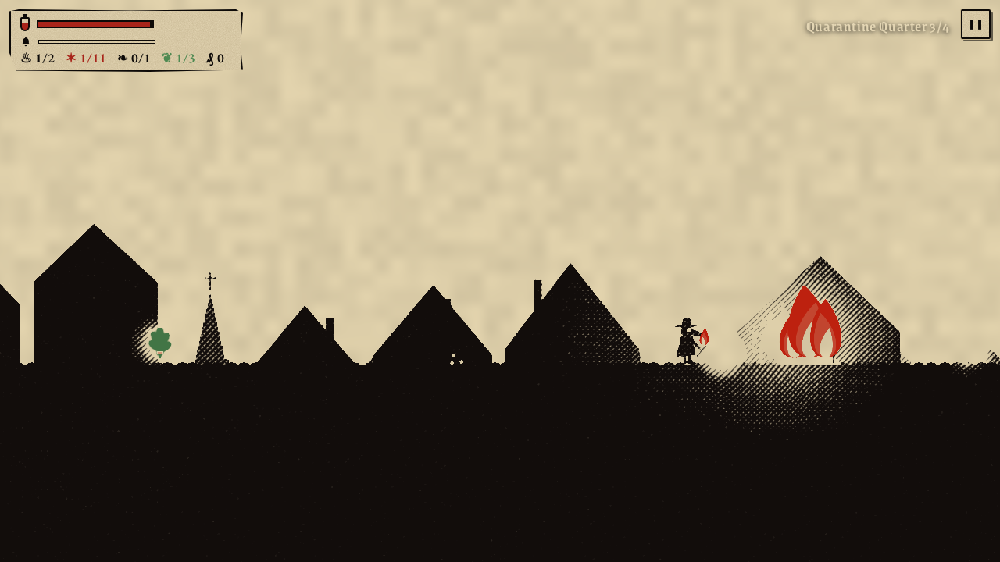
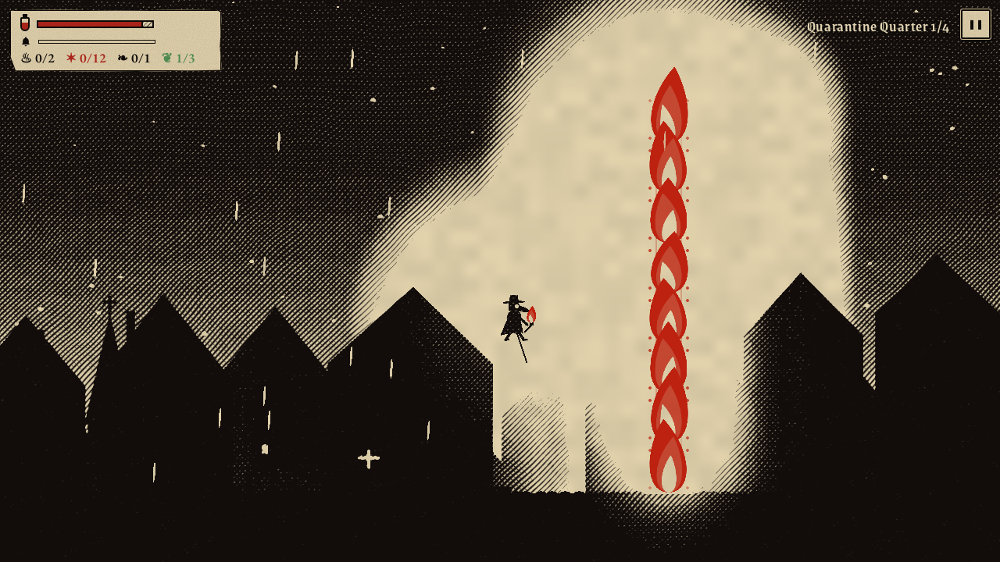
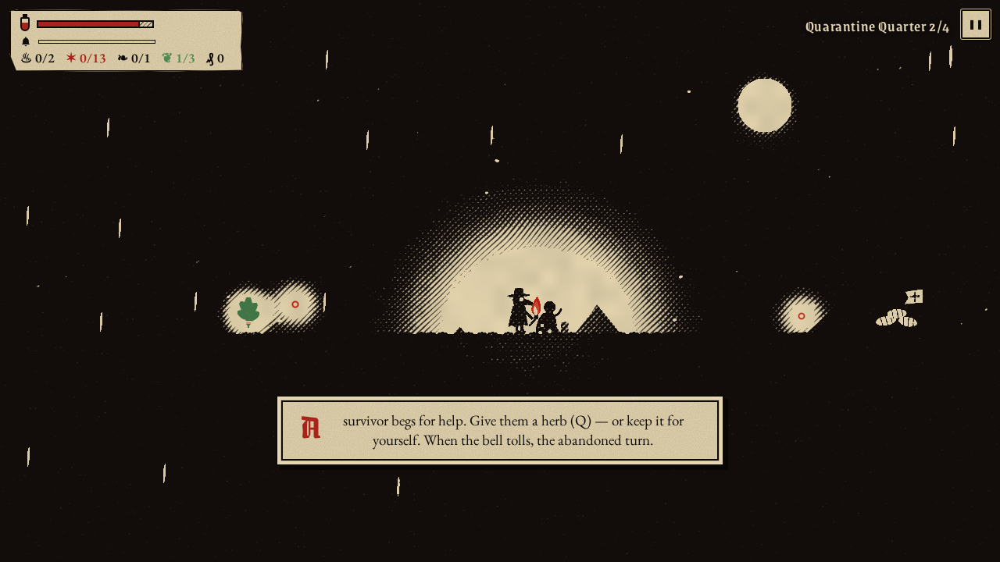
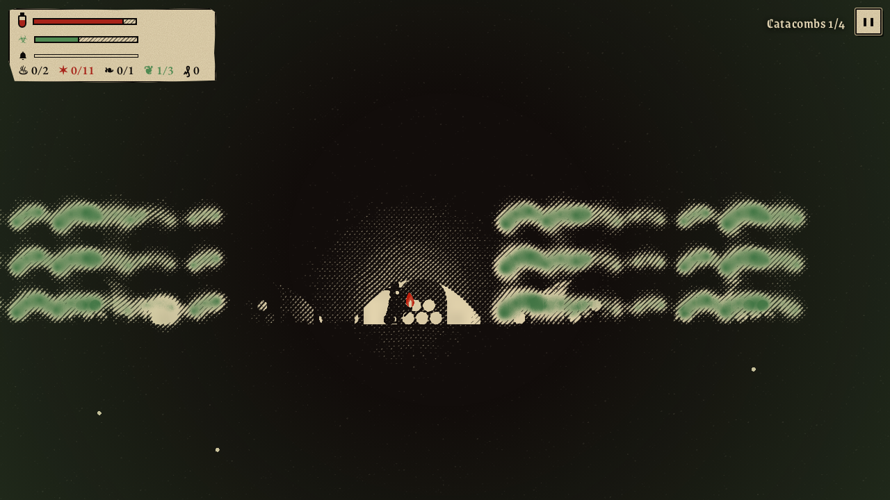
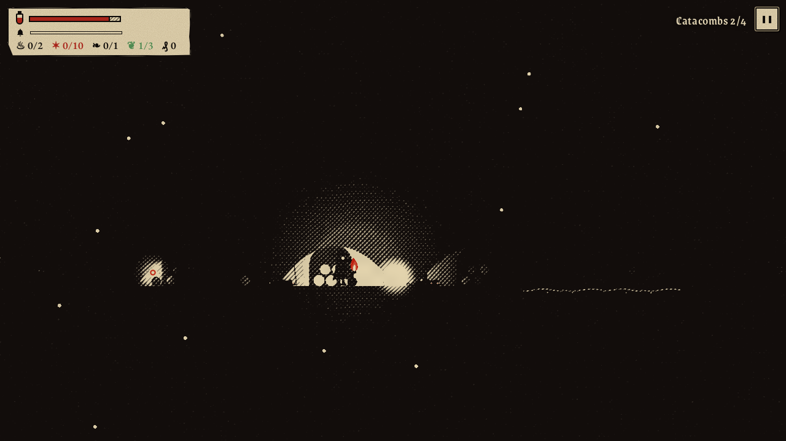
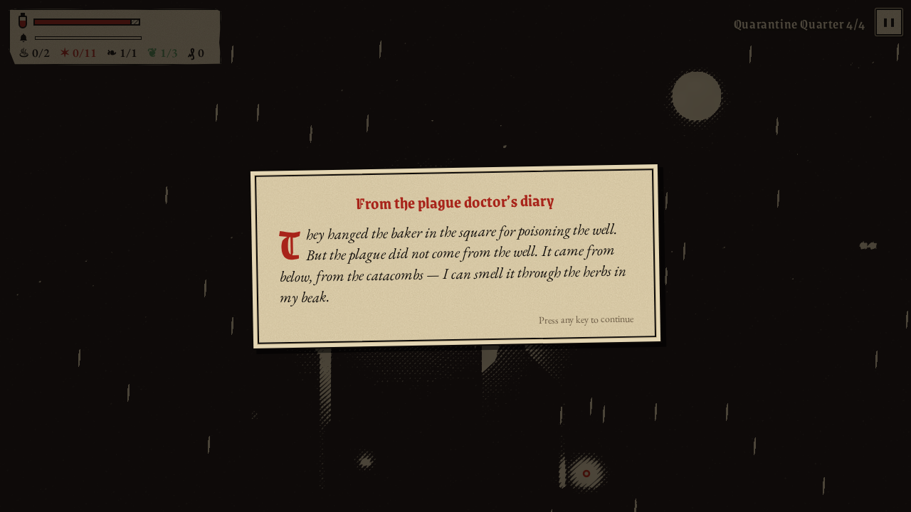
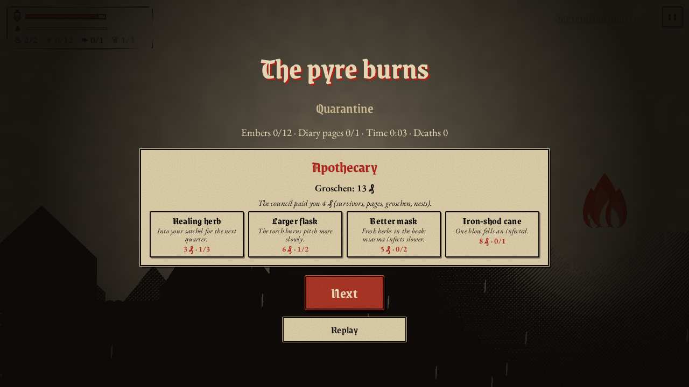

# Miasma

A dark platformer for adults, drawn like a medieval woodcut. The plague has taken the city. You are the last plague doctor: a torch in one hand, a cane in the other.

**▶ Play online: https://darangonaut.github.io/miasma/**


Miasma started as the grim older sibling of [Lumen](https://github.com/darangonaut/lumen), but it plays very differently:

- **Your light gives you away.** The bigger the flame, the farther the infected see you. A flared torch calls every infected far around, while a dying spark or a burning barricade lures them away. Rats are the opposite: they fear the light, and they tear you apart the moment you hide the torch or run out of pitch.
- **The doctor’s cane.** Strike the infected to knock them back. Two blows fell one, and one blow into a pit, onto spikes or into the sewage is enough. Jumping on heads no longer helps.
- **A mission in every quarter.** Burn all the plague nests (piles of shrouded bodies under a plague flag). Only then will the pyre at the end of the path light.
- **The plague bell.** Every so often the bell tolls and the infected pour into the streets after you. Hide the torch and they only find the spot where you stood.
- **Survivors and a choice.** Herbs go into your satchel (up to 3). Use one to cure your own infection, or give it to a survivor who begs for help. Those left behind turn when the bell tolls.
- **An apothecary between levels.** The council pays you in groschen for the saved, the diary pages, the nests and the coins you find. Buy herbs, a larger flask, a better mask or an iron-shod cane.
- **Cellars and locked houses.** Drop into cellars under the street for keys and coins. A key opens a house door with loot behind it, while the main path goes over the roof.
- **A story with three endings.** Sixteen pages of the doctor’s diary tell what the council really wanted and what grows under his cloak. How the game ends depends on how many people you saved.

Miasma also keeps the hard core of the original:

- **One touch kills.** Wraiths, the infected, rats and iron spikes give no second chance.
- **Fair warning.** Before a wraith strikes, it freezes and its eyes turn red.
- **The torch burns fast.** In total darkness you last only seconds.
- **Miasma, barricades, a hidden torch.** Green plague clouds infect you, and a flared torch burns them away. Plague barricades must be set on fire. Hold ↓ to hide the torch under your cloak.

<table>
<tr>
<td><br><sub>The cane against the infected, under a blood moon</sub></td>
<td><br><sub>A plague nest burns while lightning tears the sky open</sub></td>
</tr>
<tr>
<td><br><sub>A plague barricade in flames, which lures the infected</sub></td>
<td><br><sub>A survivor begs for a herb: their life or yours?</sub></td>
</tr>
<tr>
<td><br><sub>Catacombs: green miasma and the infection rising</sub></td>
<td><br><sub>Rats wait at the edge of the light</sub></td>
</tr>
<tr>
<td><br><sub>A page from the plague doctor’s diary</sub></td>
<td><br><sub>The apothecary after a level</sub></td>
</tr>
<tr>
<td><br><sub>Plague Pits: wind, graves and a sickly moon</sub></td>
<td><br><sub>The Cathedral: arches in the dark</sub></td>
</tr>
</table>

## Four worlds

|     | World                  | What awaits you                                                 |
| --- | ---------------------- | --------------------------------------------------------------- |
| 1   | **Quarantine Quarter** | rain, a blood moon, rooftops, barricades, the first infected    |
| 2   | **Catacombs**          | sewage, slimy stones, rat nests, miasma rising from the bones   |
| 3   | **Plague Pits**        | an open cemetery, wind in gusts, lightning, great wraiths       |
| 4   | **The Cathedral**      | hanging platforms, the bell tower, the crypt and the great pyre |

Each world has 4 levels, 16 in total.

## How to play

| Action                       | Keyboard         | Touch    |
| ---------------------------- | ---------------- | -------- |
| Walk                         | ← → / A D        | ◀ ▶      |
| Jump (hold to float further) | Space / ↑ / W    | ⤒        |
| Strike with the cane         | V / E            | ⚚        |
| Throw a spark                | C / F            | ✸        |
| Flare the torch              | Shift / X (hold) | ✦ (hold) |
| Hide the torch               | ↓ / S (hold)     | ◐ (hold) |
| Use or give a herb           | Q / H            | ❦        |
| Pause                        | Esc / P          | ❚❚       |

- The scrap of paper in the HUD shows the pitch flask, the infection, the time until the next bell, burnt nests ♨, embers ✶, diary pages ❧, herbs ❦, groschen ₰ and keys ⚷.
- **Shrines** are checkpoints. Light the candle to save your progress and refill the torch.

## Languages and mobile

English (default), Slovak and Czech; switch on the title screen. The game works in a phone browser turned sideways, with touch controls.

<p align="center"></p>

## Development

TypeScript, Vite and PixiJS 8. The graphics are vector shapes drawn in code. A full-screen shader (`src/render/woodcut.ts`) turns them into a woodcut: yellowed paper, hatching that gets denser in the shadows, solid black darkness, and colour only for fire (vermilion) and plague (verdigris). Music and sound effects are synthesized with the Web Audio API. The music is a Gregorian-style chant: a male choir built from formant filters, an ison drone and a tolling bell. There are no image or audio files.

```bash
npm install
npm run dev          # local server
npm test             # tests, including a bot that proves every level can be finished
npm run deploy:pages # build and publish to GitHub Pages
```

- `src/game/` holds pure game logic (no PixiJS or DOM): the game, the save with the apothecary (`save.ts`) and the endings (`story.ts`).
- Levels are ASCII maps generated by `scripts/build_levels.py`. The legend is in `src/game/level.ts`. The bot burns plague nests on its own, and the tests check that pitch lasts with a reserve.
- `src/render/` holds the renderer, the vector art, the plague doctor and the woodcut shader.
- `src/audio/` holds sound effects and the chant.
- Add `?classic` to the URL to turn the woodcut shader off.
