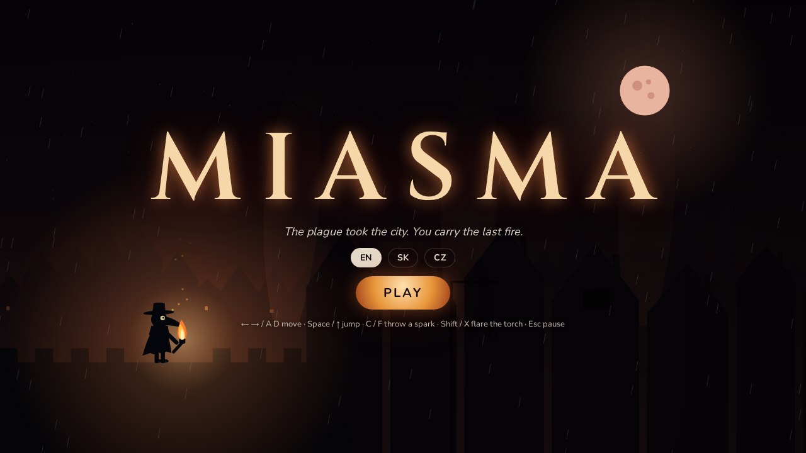
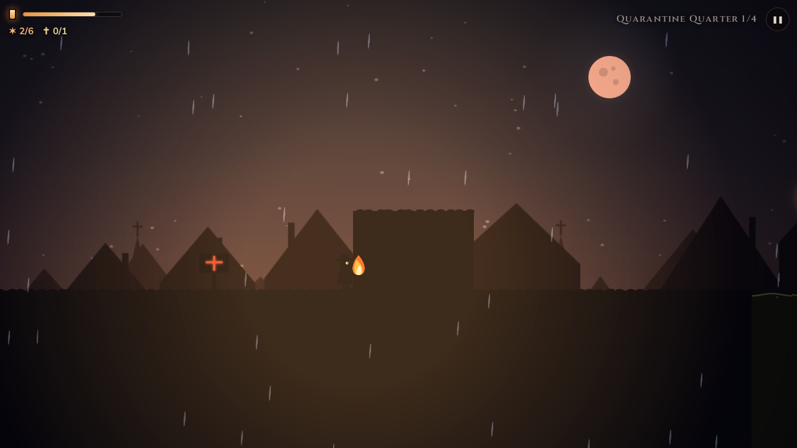
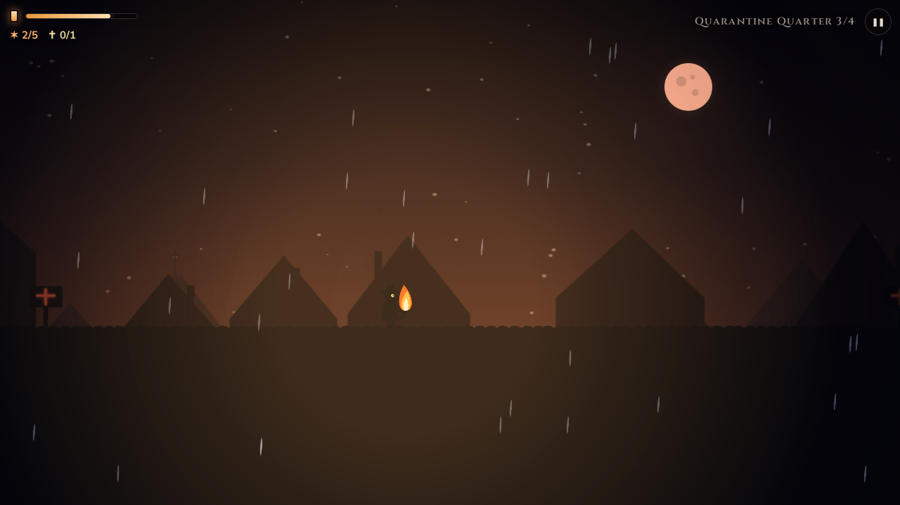
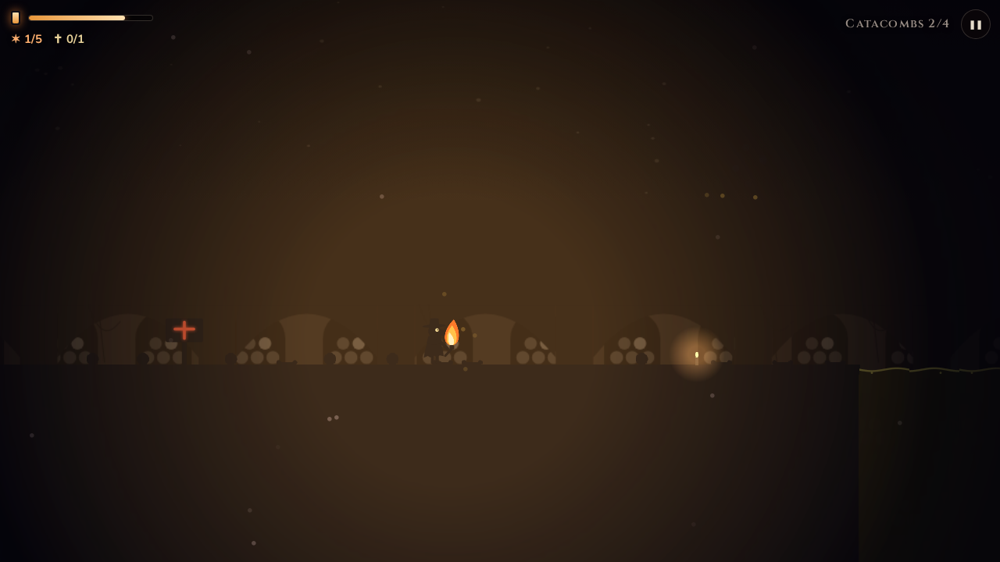
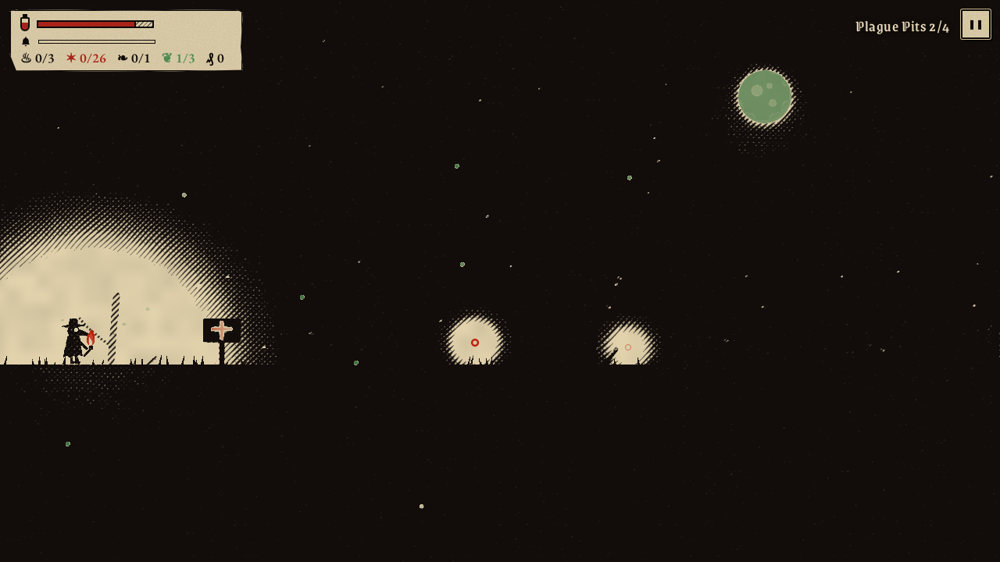
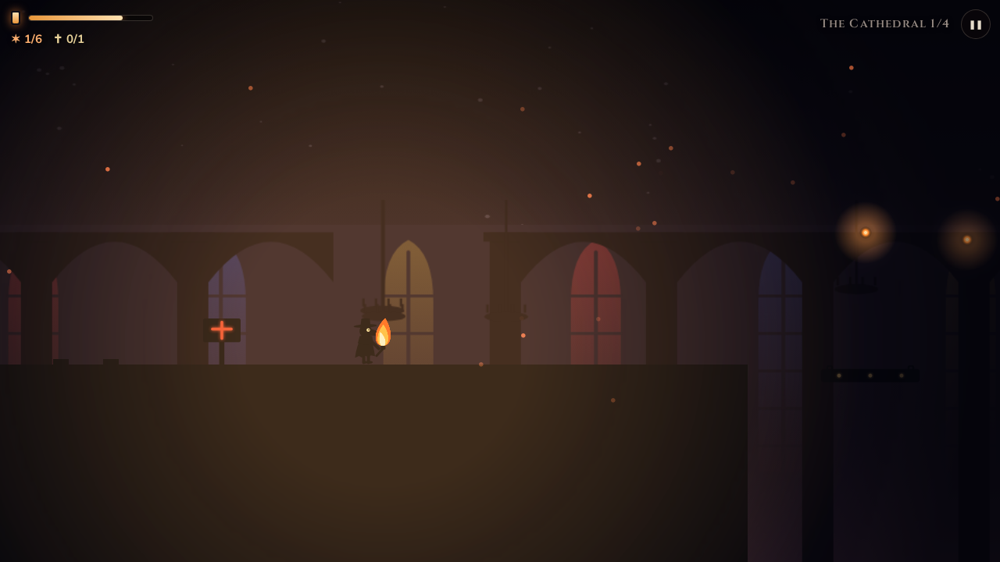
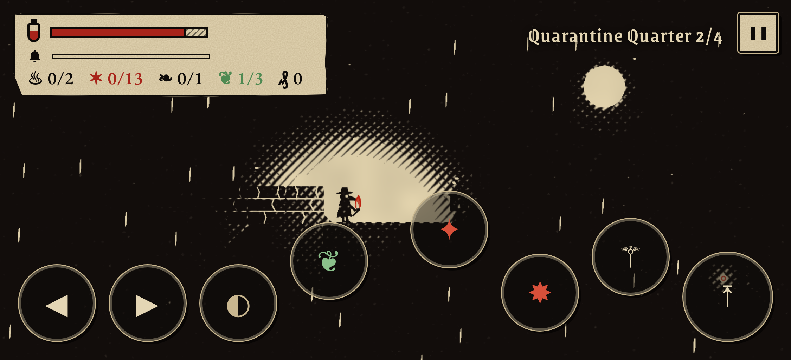

# Miasma

A dark silhouette platformer for adults. The plague has taken the city. You are the last plague doctor, and you carry the last fire.

**▶ Play online: https://darangonaut.github.io/miasma/**



Miasma is the grim older sibling of [Lumen](https://github.com/darangonaut/lumen). It runs on the same engine but has a new hero, a new world and much less mercy:

- **One touch kills.** Wraiths, the infected and iron spikes give no second chance.
- **Fair warning.** Before a wraith strikes, it freezes and its eyes turn red. That is your moment.
- **The torch burns fast.** Pitch runs out quickly, embers are rare and shrines are far apart. In total darkness you last only seconds.
- **Enemies hunt.** The infected see your fire and come for you. You can outrun them, jump on their heads, throw a spark or flare the torch and burn them.

Three mechanics are new to Miasma:

- **Miasma.** Green plague clouds infect you, and full infection kills. Get through fast or burn the cloud away with a flared torch, because fire purifies. Healing herbs cure the infection.
- **Burning barricades.** Plague barricades are too high to jump. Set them on fire with a spark or the torch, and the fire spreads to the planks next to them. It costs pitch.
- **Hiding the torch.** Hold ↓ to hide the torch under your cloak. The infected stop seeing you and wraiths lose your trail, but you move slowly and the darkness starts to swallow you.

## Four worlds

|     | World                  | What awaits you                                                 |
| --- | ---------------------- | --------------------------------------------------------------- |
| 1   | **Quarantine Quarter** | rain, a blood moon, rooftops, rotten planks, the first infected |
| 2   | **Catacombs**          | foul sewage, slimy stones, falling masonry, swarms of flies     |
| 3   | **Plague Pits**        | an open cemetery, wind in gusts, lightning, great wraiths       |
| 4   | **The Cathedral**      | hanging platforms, the bell tower, the crypt and the final pyre |

Each world has 4 levels, 16 in total. At the end of every path you light a pyre, because fire purifies.

<table>
<tr>
<td><br><sub>Quarantine Quarter: rain and a blood moon over the plague city</sub></td>
<td><br><sub>A flared torch burns everything close, but eats pitch quickly</sub></td>
</tr>
<tr>
<td><br><sub>Catacombs: walls of skulls and foul sewage</sub></td>
<td><br><sub>Plague Pits: gravestones, dead trees and a sickly moon</sub></td>
</tr>
<tr>
<td colspan="2"><br><sub>The Cathedral: stained glass faintly glowing in the dark</sub></td>
</tr>
</table>

## How to play

| Action                       | Keyboard         | Touch    |
| ---------------------------- | ---------------- | -------- |
| Walk                         | ← → / A D        | ◀ ▶      |
| Jump (hold to float further) | Space / ↑ / W    | ⤒        |
| Throw a spark                | C / F            | ✸        |
| Flare the torch              | Shift / X (hold) | ✦ (hold) |
| Pause                        | Esc / P          | ❚❚       |

- **Embers** keep the torch burning. **Relics** are hidden secrets.
- **Shrines** are checkpoints. Light the candle to save your progress and refill the torch.
- Jump on enemies' heads, throw sparks or flare the torch. A great wraith takes three hits.
- On the cemetery, jump when the wind dies down. Standing still, it can't move you, and behind a gravestone you are sheltered.

## Languages and mobile

English (default), Slovak and Czech; switch on the title screen. The game works in a phone browser turned sideways, with touch controls.

<p align="center"></p>

## Development

TypeScript, Vite and PixiJS 8. All graphics are vector shapes drawn in code, and all music and sound effects are synthesized with the Web Audio API, so there are no image or audio files.

```bash
npm install
npm run dev          # local server
npm test             # tests, including a bot that proves every level can be finished
npm run deploy:pages # build and publish to GitHub Pages
```

- `src/game/` holds pure game logic (no PixiJS or DOM).
- Levels are ASCII maps generated by `scripts/build_levels.py`. The legend is in `src/game/level.ts`.
- `src/render/` holds the renderer, the vector art and the plague doctor.
- `src/audio/` holds sound effects and music (organ chorale, viol and a tolling bell).
